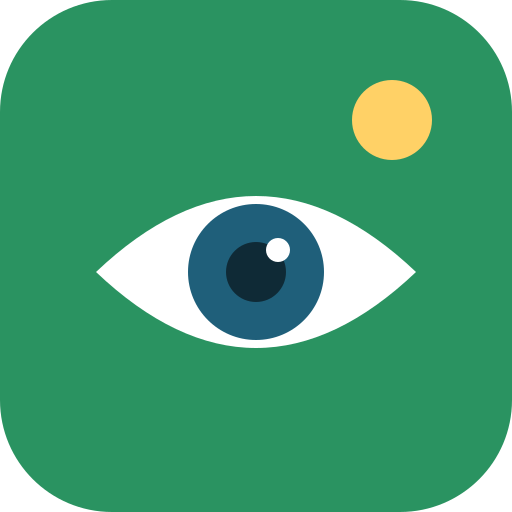
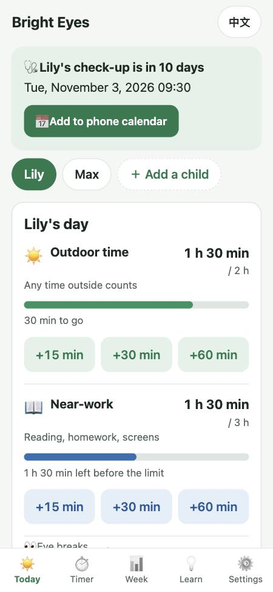
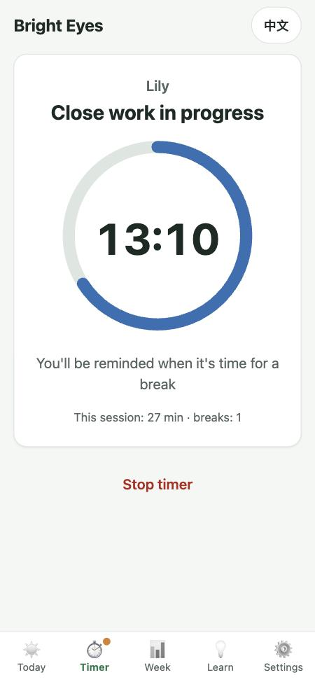
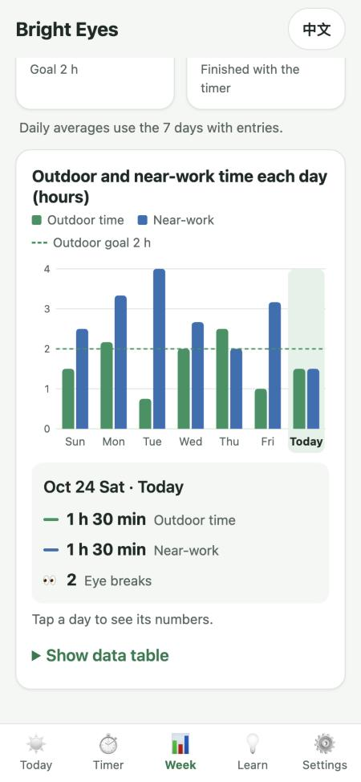
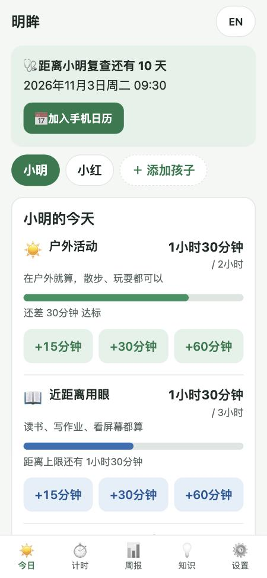
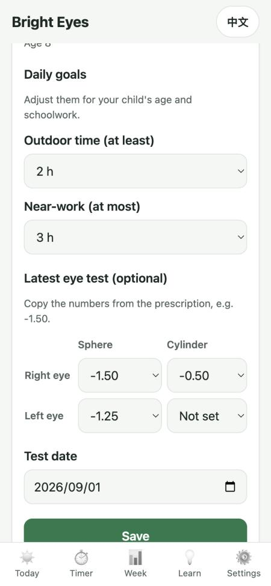
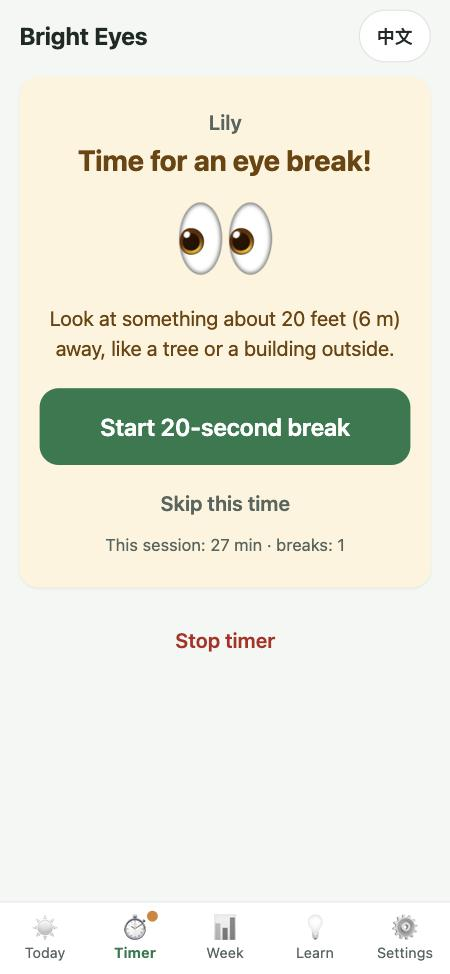
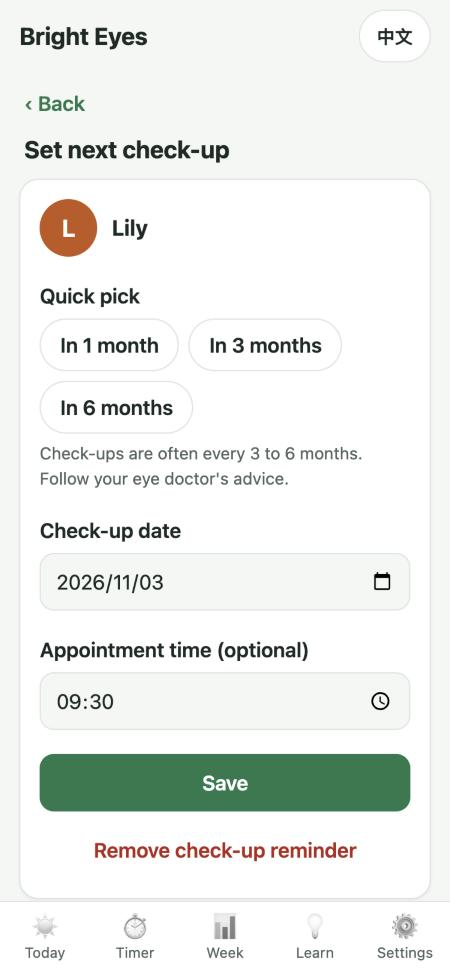
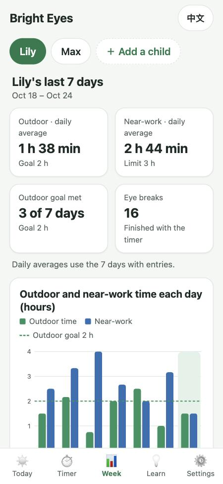
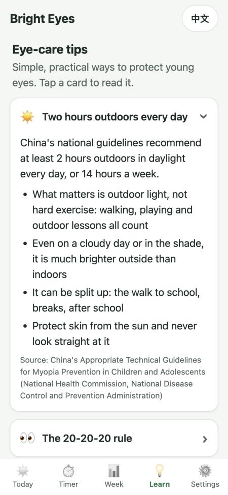

<p align="center">
  
</p>

<h1 align="center">明眸 Bright Eyes</h1>

<p align="center">
  <strong>Everyday myopia-prevention habits for children and their parents.</strong><br />
  A free, private phone app in <strong>Simplified Chinese and English</strong> that helps families spend more time outdoors,<br />
  take regular eye breaks during close work, and keep up with eye check-ups.
</p>

<p align="center">
  <a href="https://whynot-luo.github.io/bright-eyes/"><strong>Open the app</strong></a> ·
  <a href="https://whynot-luo.github.io/bright-eyes/?demo#/timer">Timer demo (15-second cycle)</a> ·
  <a href="#features">Features</a> ·
  <a href="#privacy-and-safety">Privacy</a> ·
  <a href="#for-developers">For developers</a> ·
  <a href="#roadmap">Roadmap</a>
</p>

<p align="center">
  
  &nbsp;
  
  &nbsp;
  
</p>

---

## Contents

- [Why this app exists](#why-this-app-exists)
- [Try it](#try-it)
- [Two languages](#two-languages)
- [Features](#features)
- [Privacy and safety](#privacy-and-safety)
- [What phones allow, and what they don't](#what-phones-allow-and-what-they-dont)
- [For developers](#for-developers)
- [Roadmap](#roadmap)
- [Sources for the eye-care tips](#sources-for-the-eye-care-tips)
- [License](#license)

---

## Why this app exists

Myopia (short-sightedness) in children is rising fast, and the habits that help most are simple: time outdoors in daylight, breaks from close work, and regular check-ups. They are also easy to forget.

This project was started by a high-school student who gives myopia-prevention talks in schools and local communities, and whose TV interview about ortho-k lenses and myopia has played in eye clinics for two years. The aim is to turn the advice from those talks into a tool families can use every day, in a few one-handed taps.

> **Not medical advice.** Bright Eyes helps build habits and gives reminders. It does not diagnose or treat any condition and does not replace an eye exam. This is shown on the welcome screen, on Today, on Learn and in Settings.

---

## Try it

**Open <https://whynot-luo.github.io/bright-eyes/> on a phone.** No app store, no account.

| Phone | Add it to the home screen |
|---|---|
| iPhone | Open the link in **Safari** → tap **Share** (if you can't see it, tap **···** first) → **Add to Home Screen** |
| Android | Open the link in **Chrome** → tap **Install on this phone** on the Today screen, or the browser menu **⋮** → **Add to Home screen** |
| WeChat | Links opened inside WeChat can't be installed; the app says so and asks you to tap **···** → open in browser |

Once added, it opens full-screen from its own icon (named **明眸**; on iPhone the name follows the app's language, so it may be **Bright Eyes**) and works **without internet**.

**Showing it in a talk?** Use the demo link <https://whynot-luo.github.io/bright-eyes/?demo#/timer>: the timer's 20 minutes become 15 seconds and its 20-second break becomes 5 seconds, so a whole eye-break cycle fits in under a minute.

---

## Two languages

The whole app is available in **Simplified Chinese (简体中文)** and **English**:

- **First launch** follows the phone's language: Chinese on a Chinese phone, English otherwise.
- **Switch any time** with the **中文 / EN** button in the top-right corner of every screen, or under **Settings → Language**, or on the welcome screen.
- The choice is **remembered** on the phone.
- Every on-screen text exists in both languages; an automatic test fails if a translation is missing. Dates, times and durations follow the chosen language too (for example *2小时30分钟* or *2 h 30 min*).

<p align="center">
  
  &nbsp;&nbsp;
  
  <br />
  <sub>The same screen in English and in Chinese, one tap apart.</sub>
</p>

---

## Features

### Today: log outdoor time and near-work in one tap

| | ☀️ Outdoor time | 📖 Near-work |
|---|---|---|
| Counts | Any time outside: walking, playing, outdoor lessons | Reading, homework and screens |
| Compared with | A daily **goal** to reach (default **2 h**) | A daily **limit** to stay under (default **3 h**) |
| Buttons | **+15 / +30 / +60 min** | **+15 / +30 / +60 min** |
| Status | "30 min to go" → "Outdoor goal reached today 🎉" | "1 h left before the limit" → "Today's limit reached" → "20 min over the limit" (bar turns orange) |

- Buttons stay in the same place as totals grow, so quick repeated taps never miss.
- **Today's entries** lists every tap with its time; **✕** deletes a mistake and the totals update.
- A day can't hold more than 24 hours. Each new day starts at zero, and Today refreshes when the app is reopened.
- Also on Today: how many eye breaks the child took, a shortcut to the timer, the child's profile card with the latest prescription and next check-up, and help for adding the app to the home screen.

### Several children, with profiles



- Add as many children as needed and switch with the name buttons at the top.
- **Name** (a nickname is fine, up to 20 characters) and **birth month**. The app stores the month, not an age, so the age shown is always up to date.
- **Daily goals per child**: outdoor time 30 min–4 h, near-work limit 1–6 h, in 30-minute steps.
- **Latest eye test (optional)**: sphere and cylinder for each eye, picked from lists in 0.25 steps (sphere −15.00 to +8.00, cylinder −6.00 to +4.00), plus the test date. Lists are used because the iPhone number keypad has no minus key.
- Deleting a profile asks first, and also removes that child's records, check-up reminder and any running timer.

<br clear="right" />

### 20-20-20 eye-break timer

<p>
  
  &nbsp;
  
</p>

Every 20 minutes of close work, look at something about 20 feet (6 metres) away for 20 seconds.

1. **Start** the timer for the selected child. The tap also unlocks the alert sound, asks for notification permission and keeps the screen on.
2. **Close work**: a 20:00 countdown ring.
3. **Time for an eye break!**: an orange alert with a chime, vibration on Android, a system notification if the app is in the background, and "⏰ Eye break" in the browser tab. The app switches to the Timer tab, unless the parent is filling in a form; typed text is never lost. If nobody responds, the chime repeats every 30 seconds, up to 5 times.
4. **Start 20-second break**: a green countdown. Then a chime, "Break done. Keep it up!", the break is counted, and the next 20 minutes begin. **Skip this time** doesn't count a break.
5. **Stop**: a summary ("Close work: 45 min. Eye breaks: 2.") with the choice to add the time to today's near-work, or not if it was already logged by hand.

The timer works from saved clock times, not by counting seconds, so it stays correct if the phone sleeps or the app is closed and reopened. Close work is counted only until a reminder fires, and a reminder left unanswered for an hour ends the session by itself.

### Check-up reminders



- Set each child's next eye exam with quick picks (**in 1, 3 or 6 months**), a date, and an optional appointment time. The hint says check-ups are often every 3–6 months and to follow the doctor's advice; the app never decides when a child should be checked.
- **Today shows a reminder card** from 14 days before ("Lily's check-up is in 10 days"), on the day, and after a missed date, with shortcuts to update the prescription and set the next check-up.
- **Add to phone calendar** creates a standard `.ics` calendar file on the phone, with reminders at 9:00 the day before and a week before (or a day and 2 hours before an appointment time). The phone's own calendar then reminds the family even when the app is closed. No outside calendar service is used.

<br clear="right" />

### Weekly summary

<p>
  
  &nbsp;
  
</p>

- The last 7 days for the selected child: daily averages for outdoor time and near-work (counting only days with entries), days the outdoor goal was met, and eye breaks finished with the timer.
- A column chart of outdoor vs near-work time per day on one hours axis, with the outdoor goal as a dashed line. Tap a day to see its numbers; **Show data table** lists every value.
- Chart colours were checked with a colour-blindness validator in light and dark mode, and the chart has a legend and a table, so it never relies on colour alone.

### Learn: eye-care tip cards



Eight short cards, written from Chinese national guidance; all but the last show a source line:

☀️ Two hours outdoors every day · 👀 The 20-20-20 rule · 📖 Good reading and writing posture (一尺、一拳、一寸) · 📱 Healthy screen use · 🌙 Sleep and diet · 🩺 Regular eye check-ups · 🔍 About ortho-k lenses (neutral facts only) · 💡 Signs a child may be short-sighted

The content lives in [`content/tips.js`](content/tips.js) and is easy to edit (see [Changing the content](#changing-the-content)).

<br clear="right" />

### Settings

Children's profiles, language, the disclaimer and privacy note, the version number, and **Delete all data** (asks first; keeps only the language setting, which is handy for resetting before a demo).

### Built for phones

- Bottom tab bar within thumb reach; every button is at least 44 px tall.
- Works on the smallest phones (320 px wide) without sideways scrolling.
- Follows the phone's light or dark mode.
- Works offline after the first visit and opens instantly on slow connections.

---

## Privacy and safety

These are children's data, so the app is private by design:

- **Everything stays on the phone.** Data is saved in the browser's local storage on the device. There is no account, no server, no database and nothing to sign in to.
- **No tracking.** No analytics, no advertising and no third-party scripts. The app loads nothing from other websites (no external fonts or libraries), which also helps it load in mainland China.
- **Safe text.** Anything a parent types, and the tip-card text, is escaped before it is shown, so it can never add code to the page.
- **The parent is in control.** Records can be deleted one by one, per child, or all at once.
- **Good to know:** changing phones or clearing browser data removes the records, and on iPhone, Safari may clear a website's data after about 7 days without a visit unless the app was added to the home screen.

---

## What phones allow, and what they don't

A web app has no server behind it, so some limits come from the phone, not from the code:

| Limit | Why | What the app does |
|---|---|---|
| The timer can't ring while the app is closed or the phone is locked | Phones pause web pages in the background | Keeps the screen on while timing; the timer is still correct when reopened |
| The chime may be silent | Silent mode and browser sound rules | Clear on-screen alert as well; vibration on Android |
| Vibration works on Android only | iPhone doesn't allow it for web pages | Sound and screen alert |
| Notifications need permission | System rule; on iPhone only for apps added to the home screen (iOS 16.4+) | Asks when the timer starts |
| "Add to phone calendar" behaves differently on different phones | Each calendar app handles `.ics` files its own way | Reminder cards inside the app work everywhere |
| Can't be installed from inside WeChat | WeChat's built-in browser | Detects WeChat and explains how to open in a browser |

---

## For developers

### Tech in one paragraph

Plain HTML, CSS and JavaScript (ES modules): no framework, no build step and no runtime dependencies. The files in this repository are exactly what runs on the phone. It is a Progressive Web App: a web manifest for "Add to Home Screen" and a service worker for offline use. It is hosted free on GitHub Pages.

### Run it locally

Requirements: **Python 3** to serve the files and **Node.js 20+** to run the tests and release script. There is nothing to install.

```bash
npm start            # serves the app at http://localhost:8000 (or: python3 scripts/serve.py 8000)
npm test             # runs the automatic tests
```

The local server tells the browser not to reuse old copies of files, so edits show up on a normal reload. Phones on the same Wi-Fi can open `http://<your computer's IP>:8000`. Offline mode and notifications need HTTPS, so test those on the live site.

### Tests

`npm test` runs **80 tests** with Node's built-in test runner. They cover:

- saving and loading data, including damaged storage
- that every text exists in both languages
- child profiles, age and prescriptions
- the daily log and goals
- the timer's phases, including late stops and unanswered reminders
- check-up dates and the `.ics` file format
- the weekly summary and chart scale
- the tip cards and their formatting
- that every app file is listed for offline use and the release fingerprint is current

### Publishing a change

1. Edit the files and check them with `npm start`.
2. Run **`npm run release`**. It writes a new fingerprint of all app files into `sw.js`.
3. Run `npm test`. It fails with a clear message if you forgot step 2.
4. Commit and push. GitHub Pages updates within a minute or two.

**How updates reach phones:** a changed `sw.js` tells each phone that a new version exists. In the background it downloads the whole app again as one set, switches over and deletes the old copy, so families get the new version the next time they open the app. Because the whole set is swapped at once, a phone can never end up running a mix of old and new files.

### Project structure

```
index.html              page frame: header, screen area, tab bar
manifest.webmanifest    name, icon and colours for "Add to Home Screen"
sw.js                   service worker: versioned offline copy of the app
css/app.css             all styles, light and dark mode
content/
  strings.js            every on-screen text, in Chinese and English
  tips.js               the Learn cards
js/
  app.js                start-up, screen switching, timer clock
  store.js              the only code that reads/writes saved data
  i18n.js               language detection and switching
  children.js           profiles, age, prescriptions          ┐
  log.js                daily log, goals, eye-break counts    │
  timer.js              20-20-20 timer phases                 │ pure logic: no
  checkup.js            check-up dates, .ics calendar file    │ web-page code,
  week.js               weekly summary, chart scale           │ unit-tested
  learn.js              tip-card text and formatting          │
  dates.js, escape.js   small helpers                         ┘
  ui.js                 shared HTML building blocks and formatting
  alerts.js             sound, vibration, notifications, screen wake lock
  device.js             iPhone / Android / WeChat / installed detection
  screens/              one file per screen
tests/                  automatic tests (npm test)
scripts/                local server, release fingerprint, icon maker
assets/screenshots/     images for this README
```

### Design decisions

- **One data object, one file that saves it.** Everything the app remembers is a single object saved by `js/store.js`, which makes the privacy promise easy to check.
- **Screens redraw from data.** Each screen is a function that draws itself from the saved data; a change goes `ctx.update(…)` → save → redraw. Changes that happen by themselves (the timer, the browser's install prompt) never redraw a form the parent is typing in. The part of the address after `#` picks the screen, so the phone's Back button works.
- **Clock times, not tick counting**, so the timer survives sleep and restarts.
- **Honest numbers.** The timer counts close work only until a reminder fires. Weekly averages skip days with nothing logged. Outdoor and near-work share one chart axis because both are minutes; eye breaks are a count and appear as numbers.
- **Inputs that suit phones.** Prescription values are picked from lists, birth month replaces age, and buttons sit within thumb reach.
- **Calendar files instead of push.** A server-less web app can't wake itself up, but every phone calendar can.

### Changing the content

| To change… | Edit |
|---|---|
| Learn cards | [`content/tips.js`](content/tips.js): instructions at the top; a blank line starts a paragraph, `- ` makes a bullet |
| Any on-screen text | [`content/strings.js`](content/strings.js): each text appears once in Chinese (`zh`) and once in English (`en`) |
| App name | `app.name` in `content/strings.js`, `name`/`short_name` in `manifest.webmanifest`, `<title>` in `index.html` |
| Icon | `icons/icon.svg`, then `python3 scripts/make_icons.py` (needs `pip3 install pillow`) |
| Colours | the variables at the top of `css/app.css` |
| Default goals, timer lengths, reminder window | `DEFAULT_GOALS` in `js/log.js`, `DURATIONS` in `js/timer.js`, `SOON_DAYS` in `js/checkup.js` |

After any change: `npm run release`, `npm test`, commit, push. When you add a new file, also add it to `APP_FILES` in `sw.js`; the tests will remind you.

### Porting to a WeChat mini-program

The pure-logic files (`children.js`, `log.js`, `timer.js`, `checkup.js`, `week.js`, `learn.js`, `dates.js`, `escape.js`) plus `content/strings.js` and `content/tips.js` contain no web-page code and can be reused as they are. `store.js` takes any object with `getItem`/`setItem`, for example `{ getItem: wx.getStorageSync, setItem: wx.setStorageSync }`. The screens, HTML and CSS would be rewritten as mini-program pages. Mini-program names must be unique within WeChat, so a longer name such as 明眸护眼 may be needed.

---

## Roadmap

1. **Anonymous, opt-in usage counts**, to learn how many families use the app. Off by default and only after the parent agrees; counts only, never names, prescriptions or anything that identifies a child.
2. **"Find a clinic" link** next to check-up reminders, kept neutral (no recommended providers).
3. **Backup and restore**: export the data to a file and import it on a new phone.
4. **Prescription history**: keep every eye test and show the changes over time (records only, no medical interpretation).
5. **Log earlier days**, for when a parent forgot yesterday.
6. **Pause the timer**, for example for a short interruption.
7. **Tip of the day** on the Today tab.
8. **WeChat mini-program** version (see above).

---

## Sources for the eye-care tips

The Learn cards are based on:

- 《儿童青少年近视防控适宜技术指南》 (*Appropriate Technical Guidelines for Myopia Prevention in Children and Adolescents*), National Health Commission / National Disease Control and Prevention Administration of China
- 《综合防控儿童青少年近视实施方案》 (*Comprehensive Plan for Preventing Myopia in Children and Adolescents*), Ministry of Education of China and seven other departments
- 教育部《关于进一步加强中小学生睡眠管理工作的通知》 (Ministry of Education notice on pupils' sleep)
- The 20-20-20 rule as recommended by the American Academy of Ophthalmology
- National Medical Products Administration of China (ortho-k lenses are Class III medical devices)

They are general habits for families, not individual medical advice. Always follow your eye doctor.

---

## License

No license has been chosen yet. Until one is added, all rights are reserved by the author. Please open an issue if you would like to use or adapt the project.
